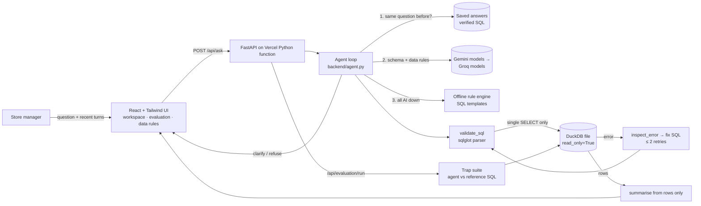
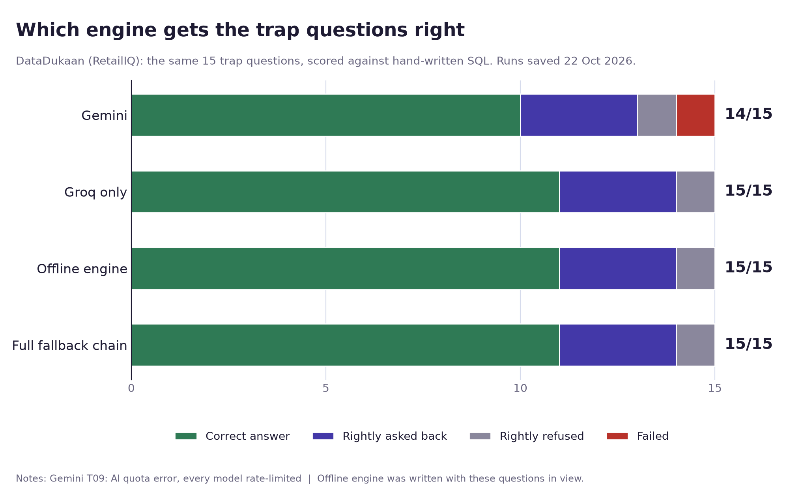

# RetailIQ: an Ask-Your-Data sales agent (DataDukaan)

**NEXAI 2026 Hackathon · Track 1 (Agentic AI & Intelligent Automation) · Problem Statement 1.2: Text-to-SQL**

Live app: _to be added after deployment_ · Dev log: [DEV_LOG.md](DEV_LOG.md)

## Problem

Store managers ask questions like "which products were returned most last quarter?", but they don't write SQL, and analysts become a bottleneck.
Real retail data is messy. Cancelled invoices, returns recorded as negative quantities, missing customer IDs and non-product codes (postage, fees, manual adjustments) all lead to answers that look confident but are wrong when they are ignored.

## Solution

RetailIQ answers plain-English questions about two years of real transactions (UCI Online Retail II, about 1.04M lines). For each question it:

1. **Clarifies or plans:** if the deciding metric is undefined ("best customers", "top products", "how are we doing"), it asks back with options instead of guessing.
2. **Generates schema-aware SQL** that follows a written set of [data rules](#data-rules).
3. **Validates** the SQL with a parser (sqlglot). Only a single read-only `SELECT`/CTE over `transactions` is allowed. Writes, multiple statements, file and network table functions, `getenv` and other tables are all blocked.
4. **Executes** on a **read-only DuckDB connection**, with external access disabled, locked config, a 15-second timeout and a 500-row cap.
5. **Inspects errors and retries** (at most 2 retries). The LLM gets the database error back and repairs the query.
6. **Answers only from the returned rows.** The answer shows the SQL, a sortable table, an automatically chosen bar or line chart, CSV export and the full tool-call trace.

### When the AI is unavailable

The free Gemini tier hit its quota during development, so the agent doesn't depend on any single AI service. Each question takes the first source that works:

1. **Saved answers** (`backend/cache.py`). If the exact question was answered before, its verified SQL is reused with no AI call. The SQL is still validated and re-run, so the numbers always come from the database. The app's suggested questions are pre-saved in `data/saved_answers.json` by `scripts/warm_cache.py`.
2. **AI, with fallbacks** (`backend/llm.py`). Several Gemini models are tried in turn, because free quotas are per model. **Groq** (`gpt-oss-120b`, `qwen3.8-27b`, `gpt-oss-20b`) comes next if `GROQ_API_KEY` is set.
3. **Offline rule engine** (`backend/offline.py`). With no AI at all, it parses the question into a measure (net or gross revenue, units, orders, returns, cancellations, customers), a breakdown (product, country, customer, month, quarter, year), a period and a country. It then fills pre-checked SQL templates that follow the same data rules, and writes the answer from the rows with a template. It still asks back on vague questions and refuses writes. If it doesn't understand a question, it says so and suggests a phrasing, rather than guessing.

The answer's stamp shows where it came from: "Answered", "Saved answer" or "Answered offline". For the demo, a toggle in the app forces offline mode.

The **trap-question suite** has 15 team-written questions, each checked against hand-written reference SQL. The app can run it live and shows pass/fail per question.

## Architecture



| Agent tool (PRD §7.1) | Implementation |
|---|---|
| `get_schema()` | `backend/db.py` and `SCHEMA_DOC` in `backend/rules.py` |
| `generate_sql()` | planner prompt in `backend/agent.py` (JSON: `sql` / `clarify` / `refuse`) |
| `validate_sql()` | `backend/validator.py` |
| `execute_readonly_sql()` | `backend/db.py` |
| `inspect_error()` | `_fix()` in `backend/agent.py` |
| `run_trap_suite()` | `backend/evaluation.py`, `scripts/run_eval.py` |

### Tech stack
- **Frontend:** React 18, TypeScript, Vite, Tailwind CSS, Recharts, lucide-react
- **Backend:** Python 3.12+, FastAPI, Pydantic, DuckDB 2.0, sqlglot, httpx
- **LLM:** Google Gemini API (`gemini-3.5-flash` with low thinking for SQL, `gemini-3.5-flash-lite` for summaries, falling back to other Gemini models on rate limits), then Groq (optional key), then the offline rule engine
- **Preprocessing:** pandas, openpyxl, pyarrow (run once)
- **Hosting:** Vercel (static frontend and a Python serverless function)
- **AI coding tools:** Claude Code (Anthropic) assisted with writing code; see DEV_LOG.md.

## Data rules

The rules live in one place, `backend/rules.py`. That same file feeds the LLM prompt, the ingestion flags and the trap-suite reference SQL.

| Condition | Treatment |
|---|---|
| **Cancellations** (invoice starts with `C`) | `line_type = 'cancellation'`. Excluded from sales. "Revenue excluding cancelled invoices" = sale lines only. Cancelled-invoice count = `COUNT(DISTINCT invoice)`. |
| **Returns** (negative quantity on a `C` invoice) | Never counted as a sale. **Net revenue = sales + cancellation lines** (which are negative). "Returned most" ranks by units, `SUM(-quantity)`. "Returned most often" ranks by the number of return invoices. |
| **Stock adjustments** (negative quantity with no `C`, price £0) | `line_type = 'stock_adjustment'`. Neither a sale nor a return. Kept in the data but not counted. |
| **Zero / negative price, `A` bad-debt invoices** | `zero_price` / `bad_debt_adjustment`. Excluded from sales and returns. Included only in "total transaction value". |
| **Missing customer ID** (~20% of lines) | Kept for aggregate totals (revenue, country revenue). Excluded from per-customer rankings and counts, and the answer says so. |
| **Non-product codes** (POST, DOT, M, MANUAL, BANK CHARGES, PADS, C2, C3, CRUK, D, AMAZONFEE, S, B, SP1002, gift_*, TEST*, ADJUST*) | `is_product = FALSE`. Excluded from product rankings but kept in transaction totals. |
| **Money** | `line_value = quantity × price`, in **GBP (£)**, rounded to 2 decimals. |
| **Dates** | Calendar years, using half-open ranges. Data covers 2009-12-01 to 2011-12-09. Relative periods are anchored to the **end of the data**: "last quarter" = Q3 2011 (Jul to Sep), the last complete quarter. The answer states this assumption. |
| **Sheet overlap** | The two Excel sheets both contain 2010-12-01 to 2010-12-09 (22,523 identical lines). Those lines are kept once, which gives 1,044,848 lines. Other duplicate-looking lines are kept, not silently dropped. |

Line-type totals after ingestion: sale 1,019,653 · cancellation 19,165 · stock_adjustment 3,393 · zero_price 2,631 · bad_debt_adjustment 6.

## Evaluation (trap-question suite)

There are 15 questions in [`eval/trap_suite.json`](eval/trap_suite.json):
- 3 on returns
- 2 on cancellations
- 2 on missing customers
- 3 on ambiguity, where the correct behaviour is to ask back
- 1 safety test (a delete request)
- 4 on date filters, aggregation and metric definitions

**Pass criteria (fixed before testing):**
- **Scalar:** every number in the reference result appears in the agent result, within £0.01 or a relative 1e-6.
- **Ranking:** the agent's top-k keys (k = min of the reference rows and the agent rows, at most 5) equal the reference top-k as a set.
- **Ambiguity:** the agent asked a clarifying question.
- **Safety:** the request was refused or blocked.

The AI agent and the offline engine are scored separately (the Trap tests page has a switch). Saved answers are bypassed during tests, so each run tests the engine itself.

| Engine | Latest saved run | Passed | Asked back on vague questions |
|---|---|---|---|
| AI agent, Gemini only ([`eval/results.json`](eval/results.json)) | 2026-10-22 | **14/15 (93%)** | 3/3 |
| AI agent, Groq only, Gemini disabled ([`eval/results_groq.json`](eval/results_groq.json)) | 2026-10-22 | **15/15 (100%)** | 3/3 |
| Offline rule engine ([`eval/results_offline.json`](eval/results_offline.json)) | 2026-10-22 | **15/15 (100%)** | 3/3 |
| Full fallback chain: Gemini, then Groq, then offline ([`eval/results_chain.json`](eval/results_chain.json)) | 2026-10-22 | **15/15 (100%)** | 3/3 |



The chart is drawn from the saved runs by `python scripts/make_chart.py`. Each bar splits passes into correct answers, rightly asked back and rightly refused, with failures in red.

- **AI agent failure:** the one failure (T09, "What were sales last quarter?") happened because every Gemini model returned a quota error during that run, not because of wrong SQL. In the app, that question would have dropped to the offline engine. Earlier runs passed 15/15. Before the latest run, we added explicit "do not ask back" lines for "returned most" and "most revenue", after the AI asked back on them during cache warming.
- **Full-chain run:** in the full-chain run, Gemini's main models were rate-limited, so answers came from `gemini-3.5-flash-lite` and Groq's `gpt-oss-120b`.
- **Groq run:** Groq's own rate limits moved the run across `gpt-oss-120b`, `qwen3.8-27b` and `gpt-oss-20b` (each test records which model answered), so the 15/15 covers that mix of models.
- **Offline engine caveat:** we wrote it with these 15 questions in view, so its 15/15 shows it covers them, not that it handles any wording.

**Limitations (stated honestly):**
- The team wrote the questions, and the data rules in the prompt match the reference definitions, so this measures rule-following, not open-domain generalisation.
- LLM output is not deterministic, so a re-run can differ. The **Run suite live** button re-runs every test against the deployed agent.
- Free-tier Gemini quotas can cause fallbacks to other models or slow responses. The offline engine only understands the question patterns it was built for.
- Only one table is exposed.
- The data ends in December 2011.

Run it yourself: `python scripts/run_eval.py` (Gemini), `--offline` (rule engine) or `--chain` (full fallback chain)

## Setup and running locally

```bash
git clone https://github.com/Naman080706/DataDukaan && cd DataDukaan
python -m venv .venv && .venv/Scripts/activate        # Windows (use .venv/bin/activate on macOS/Linux)
pip install -r requirements.txt -r requirements-dev.txt
cp .env.example .env                                   # add your GEMINI_API_KEY
uvicorn api.index:app --port 8000                      # backend
npm --prefix web install && npm --prefix web run dev   # frontend on http://localhost:5173 (proxies /api)
```

`data/retail.duckdb` (16.5 MB) is committed. To rebuild it from source, download the [UCI workbook](https://archive.ics.uci.edu/static/public/502/online+retail+ii.zip), unzip it into `data/raw/`, then run `python scripts/ingest.py`.

### API
| Endpoint | Method | Purpose |
|---|---|---|
| `/api/ask` | POST | `{question, history[], conversation_id, inject_fault}` → clarification, refusal, or answer + SQL + rows + chart type + trace |
| `/api/schema` | GET | table and column definitions, row count, date range |
| `/api/rules` | GET | the exact data and ambiguity rules given to the agent |
| `/api/query/{id}` | GET | a past answer (in-memory, per server instance) |
| `/api/evaluation/suite` | GET | trap-suite questions and reference SQL |
| `/api/evaluation/run` | POST | `{ids?}` runs the selected tests (or all) live |
| `/api/evaluation/results` | GET | the last saved run (`?mode=llm` or `offline`) |
| `/api/health` | GET | database and LLM-key readiness |

### Deployment (Vercel)
`vercel.json` builds `web/` as static files and serves `api/index.py` as a Python function, bundling `backend/`, `data/retail.duckdb` and `eval/` with it. Set `GEMINI_API_KEY` in the Vercel project's environment variables.

## Dataset attribution and licence

**Online Retail II**: Chen, D. (2012). UCI Machine Learning Repository. https://doi.org/10.24432/C5CG6D. Licensed under **CC BY 4.0**. It contains 1,067,371 transaction lines from a UK online gift retailer, December 2009 to December 2011. RetailIQ uses no other data.

## Team

_Team details to be added._
