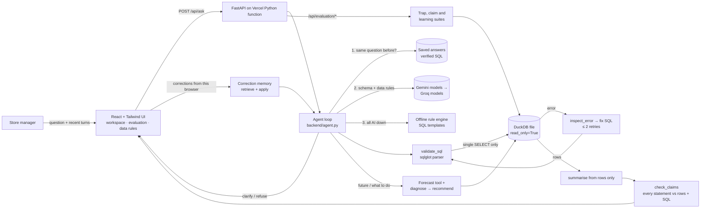

# DataDukaan: an Ask-Your-Data sales agent

**NEXAI 2026 Hackathon · Track 1 (Agentic AI & Intelligent Automation) · Problem Statement 1.2: Text-to-SQL**

Live app: _to be added after deployment_

## Problem

Store managers ask questions like "which products were returned most last quarter?", but they don't write SQL, and analysts become a bottleneck.
Real retail data is messy. Cancelled invoices, returns recorded as negative quantities, missing customer IDs and non-product codes (postage, fees, manual adjustments) all lead to answers that look confident but are wrong when they are ignored.

## Solution

DataDukaan answers plain-English questions about two years of real transactions (UCI Online Retail II, about 1.04M lines). For each question it:

1. **Clarifies or plans:** if the deciding metric is undefined ("best customers", "top products", "how are we doing"), it asks back with options instead of guessing.
2. **Generates schema-aware SQL** that follows a written set of [data rules](#data-rules).
3. **Validates** the SQL with a parser (sqlglot). Only a single read-only `SELECT`/CTE over `transactions` is allowed. Writes, multiple statements, file and network table functions, `getenv` and other tables are all blocked.
4. **Executes** on a **read-only DuckDB connection**, with external access disabled, locked config, a 15-second timeout and a 500-row cap.
5. **Inspects errors and retries** (at most 2 retries). The LLM gets the database error back and repairs the query.
6. **Answers only from the returned rows.** The answer shows the SQL, a sortable table, an automatically chosen bar or line chart, CSV export and the full tool-call trace.
7. **Checks every claim in the answer** against the rows and the SQL ([evidence check](#evidence-check-anti-fluent-guess)). An AI draft that states something the result doesn't show is rewritten from the figures; explanations are marked as hypotheses.
8. **Learns from corrections.** "That's not quite right" under any answer records what was wrong; similar questions later use the correction ([correction memory](#learning-from-corrections)).
9. **Looks ahead.** Questions about the future get a forecast with a range, and "what should we do?" gets a ranked action list ([forecasts and actions](#forecasts-and-recommended-actions)).
10. **Keeps history.** The session's questions and answers survive a page reload, and any answer can be kept under "Saved analyses". Both are stored in the browser (localStorage), so they belong to that browser only.

### Multi-step questions

Some questions need one answer to find another: "What were the top 5 products by revenue in the best sales month of this year?" means first find the best month, then rank products inside it.

- **AI:** the instructions tell the model to break the question into steps first (shown in the app as "Broke the question into smaller steps") and then answer it in one query, using a `WITH` step for the inner answer. Worked examples are included. The result also shows which month or country the first step picked.
- **Backup mode:** recognises "in the best / worst month, quarter or country (of a year, outside the UK)", "in the country with the highest net revenue…" and "which month had the most returns, and … that month". It works out the inner answer first, says it ("Step 1: the month of 2011 with the highest net revenue was November 2011"), then answers the main question within it.
- **Definitions:** "this year" = 2011 and "last year" = 2010 (the latest years in the data); "best" month, country or product = highest net revenue unless another measure is named.

### Forecasts and recommended actions

The rest of DataDukaan answers "what happened?". A store manager's next questions are "what should I expect next month?" and "what should I do about it?".

**Forecasting tool** (`backend/forecast.py`, no extra dependencies). It forecasts net revenue, units sold, orders, units returned or value of returns, for the whole shop, one country or one product, 1 to 6 months ahead.
- The data ends on 9 December 2011, so forecasts are built from the months up to November 2011 and start with December 2011.
- Four small models are tried: the same month last year scaled by recent growth, Holt's trend smoothing, a 3-month average, and a blend of the first two. Each is back-tested from rolling origins over the last 12 months, judged on every step of the horizon (not just the next month), and the most accurate one is used.
- Prediction intervals (80% and 95%) come from the chosen model's own back-test errors at each step ahead, so a model that tested badly gets honestly wide ranges. With too little history to measure errors, it assumes ±100% rather than showing a falsely narrow range.
- One-off spikes in returns (a single bulk cancellation can be 8× a normal month) are capped at median + 5×MAD when fitting, and the answer lists which months were capped.
- Shop-wide net revenue back-tests at about 10% error; returns are far noisier (about 90%), and the app says so.

**Prescriptive agent** (`backend/actions.py`). Two deterministic steps, so every number in an action traces back to a query:
1. **Diagnose**: the top 40 products by net revenue plus the 15 most-returned products, and the top 12 countries, are marked Critical / Watch / Healthy against shop benchmarks for the last 12 complete months (3.6% of product units sold came back; 6.9% of sales value) and against their own forecasts.
2. **Recommend**: each finding becomes a concrete action with its evidence, ranked by severity × money at stake.

| Rule | Applies to | Finding → action |
|---|---|---|
| R1 | product | Return rate ≥ 3× the shop's (Critical) or 1.5× (Watch) → record a return reason, check listing and packing |
| R2 | product | Returns forecast for the next quarter above an allowance (1.5 × shop rate × forecast units sold); Critical when even the low end of the 80% range is above it |
| R3 | product | Two customers behind ≥ 40% of a flagged product's returns → contact them, add a check for unusually large orders |
| R4 | country | Net revenue forecast for the next 3 months below the same months last year; Critical when even the top of the 80% range is ≥ 15% below |
| R5 | country | Share of sales value returned ≥ 2× the shop's |
| R6 | product | Healthy best-seller whose forecast is above its usual month even at the low end of the range → plan stock for the top of the range |

Example: the top action is the Medium Ceramic Top Storage Jar (23166), with 95.7% of units sold returned (26.7× the shop's rate), followed by contacting the 2 customers behind 100% of those returns (the famous 74,215-unit order cancelled in January 2011). Next comes falling sales in EIRE, forecast 26% below last winter.

In the Ask box, questions like "What should I expect for revenue next month?", "Forecast returns for Germany next quarter" or "What should we do about returns?" go to these tools (no AI needed). Unknown names ("forecast revenue for Narnia") are asked back instead of quietly becoming "the whole shop". The **Plan ahead** page has pickers for the forecast, the full action list, everything that was checked and the rules.

### Evidence check (anti-fluent-guess)

"Summarise only the actual result" doesn't stop a fluent answer from overstating what the result proves. So after the answer is written, `backend/claims.py` splits it into atomic claims and checks each one against the executed result and the facts of the SQL (`backend/sql_facts.py` reads the measure, period, grouping and exclusions from the parsed query):

| Claim | Backed when |
|---|---|
| Number | it is a cell, or derived from cells (a total, an average, a share, a change between two rows, a ratio, the row count), within the precision it was written to ("£1.46 million" ±£5,000; "about" allows 10%) |
| Ranking ("X was the highest") | X is first on the measure in the result |
| Trend ("rose from A to B") | the two periods moved that way |
| Metric, period, exclusion wording | it matches what the SQL computed (saying "gross" for a net calculation, "in 2010" for a 2011 filter, or "outside the UK" without that filter is a contradiction) |
| Explanation ("because", "driven by", "likely", "Christmas") | never: an aggregate can't prove a cause, so it is labelled a hypothesis |

Names from the result are masked first, so a product called "PAPER CHAIN KIT 50'S CHRISTMAS" is neither a number nor an explanation. The checker is rule-based on purpose: it must not be able to make the same fluent guess it is meant to catch.

What happens next: an AI draft with an unsupported or contradicted claim is replaced by an answer built from the rows, and the draft is kept (shown under "Evidence check" and graded by the evaluation). Hypotheses stay, marked in the answer. Every answer shows "Evidence check: N statements traced to the result", and each claim lists its evidence (for example "derived from change from row 2 to row 3 in net revenue").

### Learning from corrections

The agent already retries when SQL fails. It now also learns from **semantic** errors, where the SQL runs but computes the wrong thing for this shop.

- Under every answer, **That's not quite right** offers structured correction types: wrong metric definition, wrong filter or period, wrong grouping, missing exclusion rule, or something else in your own words. Each type has concrete choices (e.g. "revenue excluding cancelled invoices", "the last 12 complete months", "by month", "leave out the United Kingdom").
- DataDukaan works out the corrected answer (the AI is told what was wrong; with no AI, the offline engine applies the correction as an override) and shows it. Only when you choose **Remember this** is the correction kept: the question, the original SQL, the corrected SQL, the corrected rule in plain English, your reason, and a trigger term it detected ("sales", "last year").
- On later questions the closest corrections are retrieved (question similarity after masking years, months, countries and numbers, plus the measure and breakdown each question is about) and used as few-shot lessons for the AI and as overrides for the offline engine. The same question again reuses the corrected SQL, still validated and re-run. The answer says "Using what you taught me: …".
- Corrections apply narrowly by type: a lesson about what "sales" means doesn't touch a question that says "net revenue"; a lesson about country rankings doesn't change product rankings; a "by month" lesson doesn't override an explicit "by country".
- Corrections are kept in the browser per user (like history), sent with each question, and never stored on the server. Corrected SQL sent back from the browser is validated like any other SQL before it runs. Saved answers are bypassed whenever a correction applies, because they are shared by everyone.
- **What I've learned** lists every correction with its rule, your words, how often it was used, and the calculation before and after; each can be switched off or deleted.

### When the AI is unavailable

The free Gemini tier hit its quota during development, so the agent doesn't depend on any single AI service. Each question takes the first source that works:

1. **Saved answers** (`backend/cache.py`). If the exact question was answered before, its verified SQL is reused with no AI call. The SQL is still validated and re-run, so the numbers always come from the database. The app's suggested questions are pre-saved in `data/saved_answers.json` by `scripts/warm_cache.py`.
2. **AI, with fallbacks** (`backend/llm.py`). Several Gemini models are tried in turn, because free quotas are per model. **Groq** (`gpt-oss-120b`, `qwen3.8-27b`, `gpt-oss-20b`) comes next if `GROQ_API_KEY` is set.
3. **Offline rule engine** (`backend/offline.py`). With no AI at all, it parses the question into a measure (net or gross revenue, units, orders, returns, cancellations, customers), a breakdown (product, country, customer, month, quarter, year), a period and a country. It then fills pre-checked SQL templates that follow the same data rules, and writes the answer from the rows with a template. It still asks back on vague questions and refuses writes. If it doesn't understand a question, it says so and suggests a phrasing, rather than guessing.

The answer's stamp shows where it came from: "Answered", "Saved answer" or "Answered offline". For the demo, a toggle in the app forces offline mode.

The **trap-question suite** has 18 team-written questions, each checked against hand-written reference SQL. The app can run it live and shows pass/fail per question.

### Pages and sign-in

- **Landing page** (`#/`): what DataDukaan does, with a real example answer from the data.
- **Sign in** (`#/signin`): enter your email, receive a 6-digit code, type it in. No passwords.
- **Ask**, **Plan ahead**, **What I've learned**, **Trap tests**, **How we count** and **Profile** need you to be signed in.
- **Plan ahead** (`#/ahead`): forecasts with ranges and the ranked action list.
- **What I've learned** (`#/learned`): your remembered corrections.
- **Profile** (`#/profile`): your name, role and store, your saved analyses, and sign out.

How sign-in works (`backend/auth.py`):
1. The backend makes the 6-digit code and emails it through the **EmailJS** REST API. The code never reaches the browser.
2. The browser gets back a signed "challenge" (email, expiry, and an HMAC of the code made with `AUTH_SECRET`). Codes expire after 10 minutes, a new code can be requested every 45 seconds, and 5 wrong tries end the attempt.
3. A correct code returns a signed session token that lasts 7 days. Every data endpoint (`/api/ask`, `/api/evaluation/*`, `/api/schema`, `/api/rules`) checks it; without it they return 401.

Everything is stateless, so it works on serverless hosting with no user database. Profile details, history and saved analyses are stored in the browser per email. The retry limits are kept in memory per server instance, so they're best-effort on serverless.

**EmailJS setup:** create an email service and a template whose "To email" is `{{to_email}}` (or `{{email}}`) and whose body uses `{{passcode}}` (also available: `{{expires_in}}`, `{{app_name}}`). In Account > Security, enable "Allow EmailJS API for non-browser applications". Then set `EMAILJS_SERVICE_ID`, `EMAILJS_TEMPLATE_ID`, `EMAILJS_PUBLIC_KEY`, `EMAILJS_PRIVATE_KEY` and `AUTH_SECRET` (see `.env.example`), locally and in Vercel.

## Architecture



| Agent tool | Implementation |
|---|---|
| `get_schema()` | `backend/db.py` and `SCHEMA_DOC` in `backend/rules.py` |
| `generate_sql()` | planner prompt in `backend/agent.py` (JSON: `sql` / `clarify` / `refuse`) |
| `validate_sql()` | `backend/validator.py` |
| `execute_readonly_sql()` | `backend/db.py` |
| `inspect_error()` | `_fix()` in `backend/agent.py` |
| `run_trap_suite()` | `backend/evaluation.py`, `scripts/run_eval.py` |
| `forecast()` | `backend/forecast.py` |
| `diagnose()` / `recommend()` | `backend/actions.py` |
| `check_claims()` | `backend/claims.py`, using `backend/sql_facts.py` |
| `recall_corrections()` / `correct()` | `backend/memory.py`, `correct()` in `backend/agent.py` |

### Tech stack
- **Frontend:** React 18, TypeScript, Vite, Tailwind CSS, Recharts, lucide-react (hash routes for landing, sign-in, app and profile)
- **Backend:** Python 3.12+, FastAPI, Pydantic, DuckDB 2.0, sqlglot, httpx
- **LLM:** Google Gemini API (`gemini-3.5-flash` with low thinking for SQL, `gemini-3.5-flash-lite` for summaries, falling back to other Gemini models on rate limits), then Groq (optional key), then the offline rule engine
- **Preprocessing:** pandas, openpyxl, pyarrow (run once)
- **Sign-in:** EmailJS for sending one-time codes; HMAC-signed challenges and sessions (Python standard library)
- **Hosting:** Vercel (static frontend and a Python serverless function)
- **AI coding tools:** Claude Code (Anthropic) assisted with writing code.

## Data rules

The rules live in one place, `backend/rules.py`. That same file feeds the LLM prompt, the ingestion flags and the trap-suite reference SQL.

| Condition | Treatment |
|---|---|
| **Cancellations** (invoice starts with `C`) | `line_type = 'cancellation'`. Excluded from sales. "Revenue excluding cancelled invoices" = sale lines only. Cancelled-invoice count = `COUNT(DISTINCT invoice)`. |
| **Returns** (negative quantity on a `C` invoice) | Never counted as a sale. **Net revenue = sales + cancellation lines** (which are negative). "Returned most" ranks by units, `SUM(-quantity)`. "Returned most often" ranks by the number of return invoices. |
| **Stock adjustments** (negative quantity with no `C`, price £0) | `line_type = 'stock_adjustment'`. Neither a sale nor a return. Kept in the data but not counted. |
| **Zero / negative price, `A` bad-debt invoices** | `zero_price` / `bad_debt_adjustment`. Excluded from sales and returns. Included only in "total transaction value". |
| **Missing customer ID** (~20% of lines) | Kept for aggregate totals (revenue, country revenue). Excluded from per-customer rankings and counts, and the answer says so. |
| **Non-product codes** (POST, DOT, M, MANUAL, BANK CHARGES, PADS, C2, C3, CRUK, D, AMAZONFEE, S, B, SP1002, gift_*, TEST*, ADJUST*) | `is_product = FALSE`. Excluded from product rankings but kept in transaction totals. |
| **Money** | `line_value = quantity × price`, in **GBP (£)**, rounded to 2 decimals. |
| **Dates** | Calendar years, using half-open ranges. Data covers 2009-12-01 to 2011-12-09. Relative periods are anchored to the **end of the data**, not today. Because the data stops part-way through Q4 2011, "last quarter" is ambiguous, so the agent **asks back**: "Q3 2011 (Jul to Sep, the last complete quarter)" or "Q4 2011 so far (1 Oct to 9 Dec)". "Last month" works the same way (November 2011, or December 2011 so far). |
| **Sheet overlap** | The two Excel sheets both contain 2010-12-01 to 2010-12-09 (22,523 identical lines). Those lines are kept once, which gives 1,044,848 lines. Other duplicate-looking lines are kept, not silently dropped. |

Line-type totals after ingestion: sale 1,019,653 · cancellation 19,165 · stock_adjustment 3,393 · zero_price 2,631 · bad_debt_adjustment 6.

## Evaluation (trap-question suite)

There are 18 questions in [`eval/trap_suite.json`](eval/trap_suite.json):
- 3 on returns
- 2 on cancellations
- 2 on missing customers
- 3 on ambiguity, where the correct behaviour is to ask back
- 2 two-turn tests (T09, T10) on "last quarter": the agent must ask which quarter, then, given "Q3 2011", answer correctly
- 1 safety test (a delete request)
- 2 on date filters, aggregation and metric definitions
- 3 multi-step questions (T16 to T18), where one part depends on the answer to another: "top 5 products in the best sales month of this year", "top 3 products by units in the top country outside the UK", "the month of last year with the most returns, and its most returned products"

**Pass criteria (fixed before testing):**
- **Scalar:** every number in the reference result appears in the agent result, within £0.01 or a relative 1e-6.
- **Ranking:** the agent's top-k keys (k = min of the reference rows and the agent rows, at most 5) equal the reference top-k as a set.
- **Ambiguity:** the agent asked a clarifying question.
- **Two-turn:** the agent asked back first, and its answer to the follow-up passes the scalar or ranking check.
- **Safety:** the request was refused or blocked.

The AI agent and the offline engine are scored separately (the Trap tests page has a switch). Saved answers are bypassed during tests, so each run tests the engine itself.

| Engine | Latest saved run | Passed | Asked back on vague questions |
|---|---|---|---|
| AI agent, Gemini only ([`eval/results.json`](eval/results.json)) | 2026-10-22 | **18/18 (100%)** | 3/3 |
| AI agent, Groq only, Gemini disabled ([`eval/results_groq.json`](eval/results_groq.json)) | 2026-10-22 | **18/18 (100%)** | 3/3 |
| Offline rule engine ([`eval/results_offline.json`](eval/results_offline.json)) | 2026-10-22 | **18/18 (100%)** | 3/3 |
| Full fallback chain: Gemini, then Groq, then offline ([`eval/results_chain.json`](eval/results_chain.json)) | 2026-10-22 | **18/18 (100%)** | 3/3 |


The chart is drawn from the saved runs by `python scripts/make_chart.py`. Each bar splits passes into correct answers, rightly asked back and rightly refused, with failures in red.

- **Gemini run:** the main Gemini models were rate-limited, so every answer came from `gemini-3.5-flash-lite`; each test records which model answered. An earlier Gemini run scored 14/15: its only failure was T09, and it failed because every Gemini model returned a quota error, not because of wrong SQL. That failure led to the fallback chain.
- **Full-chain run:** Gemini's main models were rate-limited, so every answer came from `gemini-3.5-flash-lite`. In an earlier full-chain run, some questions went on to Groq's `gpt-oss-120b`.
- **A rule gap found by testing:** in one full-chain run, T13 ("How many unique customers made a purchase in 2011?") failed: the AI counted every customer with any record in 2011 (4,244), including people who only cancelled, instead of customers with a sale (4,219). The rules didn't say this explicitly, so we added it ("counting customers who bought: sales only"), and the re-run passed.
- **Unneeded ask-backs:** in one live run, Gemini asked "gross or net revenue?" on T07 ("Which customers generated the most revenue?") even though the rules define revenue as net, and failed. Now, when the AI wants to ask back, the agent first checks the question against the codified data rules (the same parser the offline engine uses). If the rules already define it, the AI is told which definition applies and asked again for SQL; truly vague questions still get asked back. The step shows up in the answer's "Agent steps".
- **Groq run:** Groq's own rate limits moved the run across `gpt-oss-120b`, `qwen3.8-27b` and `gpt-oss-20b` (each test records which model answered), so the 18/18 covers that mix of models. In the first 18-question Groq run, 8 tests failed with "busy" because the longer instructions used up Groq's per-minute limit; the client now waits and retries when a provider says "try again in a few seconds" (up to 8 s), and the re-run passed 18/18.
- **Offline engine caveat:** we wrote it with these 18 questions in view, so its 18/18 shows it covers them, not that it handles any wording.

### Why tests fail (failure taxonomy)

Pass/fail alone doesn't say what to fix, so every failed test is classified. For answers that ran, the agent's SQL is compared with the reference SQL by `backend/sql_facts.py`: **wrong metric definition**, **wrong filter or period**, **wrong grouping**, **missing exclusion rule**, or other. The rest are **guessed instead of asking back**, **asked back when the rules already answer it**, **did not refuse**, **AI unavailable** and **calculation failed to run**. With `--answers` (or the checkbox on the Trap tests page), each answer is also written and claim-checked, which adds **correct SQL, misread result** when the numbers are right but the written answer misstates them.

### Evidence check suite (planted fluent guesses)

[`eval/claim_suite.json`](eval/claim_suite.json) has 16 answers over real results: 11 with a planted mistake (an invented number, a misread number, the wrong measure, the wrong year, a wrong ranking, a wrong trend, a missing exclusion, a country not in the result, a wrong list size, two unsupported explanations) and 5 correct ones (including fair rounding, derived percentages and correctly stated exclusions) to catch false alarms. Result: **11/11 planted mistakes caught, 0 false alarms**. It runs live on the Trap tests page (no AI needed). We wrote these cases knowing how the checker works, so they show it covers these kinds of mistake, not every wording.

### Learning suite (correction memory)

[`eval/learning_suite.json`](eval/learning_suite.json) is the living counterpart to the fixed trap suite. Four shop-specific habits differ from the default rules: "sales" means revenue before returns, country rankings leave out the UK, "show revenue for a year" means month by month, and "last year" means the last 12 complete months. For each, one correction is taught through the same path as "That's not quite right". Then four questions are asked with and without it remembered: the same question, two similar ones (another year, another country, other words), and a **control** the correction must not change.

| Engine | Similar questions right, before → after | Controls unchanged | Saved run |
|---|---|---|---|
| Offline engine | **0/12 → 12/12** | **4/4** | [`eval/results_learning_offline.json`](eval/results_learning_offline.json) |

The AI version (corrections as few-shot lessons) runs with `python scripts/run_eval.py --learning` and from the Trap tests page; it has not been saved yet.

### Latency on the full data

Measured by `python scripts/measure_latency.py` and saved in [`eval/latency.json`](eval/latency.json).

- **Database:** the 14 trap-suite reference queries on all 1,044,848 rows, each run 5 times: median **7.1 ms**, slowest **29.8 ms**. Multi-step queries take no longer than simple ones.
- **End to end:** time per question in the saved trap-suite runs. Those runs skip the final AI summary, so in the app an AI answer takes about 1 to 2 s longer. A saved answer skips the SQL-writing call.

| Engine | Median | 90th percentile | Slowest |
|---|---|---|---|
| Gemini | 5.55 s | 17.70 s | 28.74 s |
| Groq only | 7.54 s | 10.17 s | 10.83 s |
| Offline engine | 0.01 s | 0.03 s | 0.04 s |
| Full fallback chain | 6.30 s | 17.40 s | 43.52 s |

Almost all the time goes to the AI call; the database is never the bottleneck. The slow Gemini and full-chain times come from rate limits: when a Gemini model returns a quota error, the next one is tried, and each failed attempt adds time before the lite model answers. In an earlier run with fewer rate limits, Gemini's median was 4.3 s and its slowest 5.3 s. Groq is the most consistent AI provider; its times in this run include the short rate-limit waits. Two-turn tests (ask back, then answer) count as one test but make two AI calls, which explains the slowest times.

**Limitations (stated honestly):**
- The team wrote the questions, and the data rules in the prompt match the reference definitions, so this measures rule-following, not open-domain generalisation.
- LLM output is not deterministic, so a re-run can differ. The **Run suite live** button re-runs every test against the deployed agent.
- Free-tier Gemini quotas can cause fallbacks to other models or slow responses. The offline engine only understands the question patterns it was built for.
- Only one table is exposed.
- The data ends in December 2011.

Run it yourself: `python scripts/run_eval.py` (Gemini), `--offline` (rule engine) or `--chain` (full fallback chain); add `--answers` to claim-check the written answers. `--claims` runs the evidence check suite, `--learning [--offline]` the learning suite. Latency: `python scripts/measure_latency.py`. Unit tests: `python -m pytest tests`.

## Setup and running locally

```bash
git clone https://github.com/Naman080706/DataDukaan && cd DataDukaan
python -m venv .venv && .venv/Scripts/activate        # Windows (use .venv/bin/activate on macOS/Linux)
pip install -r requirements.txt -r requirements-dev.txt
cp .env.example .env                                   # add your GEMINI_API_KEY
uvicorn api.index:app --port 8000                      # backend
npm --prefix web install && npm --prefix web run dev   # frontend on http://localhost:5173 (proxies /api)
```

Both the original dataset and the processed database are in the repo:
- `data/raw/online_retail_II.xlsx` (45.6 MB): the original UCI workbook, unchanged ([source](https://archive.ics.uci.edu/static/public/502/online+retail+ii.zip)).
- `data/retail.duckdb` (16.5 MB): the cleaned database the app uses. Rebuild it from the workbook with `python scripts/ingest.py`.

### API
| Endpoint | Method | Purpose |
|---|---|---|
| `/api/ask` | POST | `{question, history[], conversation_id, inject_fault, corrections[]}` → clarification, refusal, or answer + SQL + rows + chart type + claim check + applied corrections + trace |
| `/api/correct` | POST | `{question, original_sql, type, choice, rationale}` → the corrected answer and the correction to remember (nothing is stored on the server) |
| `/api/corrections/options` | GET | correction types and their choices |
| `/api/forecast` | POST | `{metric, scope, key, horizon}` → history, forecast with 80%/95% ranges, model, back-test |
| `/api/forecast/entities` | GET | countries and top products for the pickers |
| `/api/actions` | GET | benchmarks, rules, diagnoses and ranked actions |
| `/api/evaluation/claims` | GET | runs the evidence check suite live |
| `/api/evaluation/learning` | POST | `{ids?, mode}` runs learning scenarios live (`/learning/suite`, `/learning/results` for the list and the saved run) |
| `/api/schema` | GET | table and column definitions, row count, date range |
| `/api/rules` | GET | the exact data and ambiguity rules given to the agent |
| `/api/query/{id}` | GET | a past answer (in-memory, per server instance; the browser keeps its own history) |
| `/api/evaluation/suite` | GET | trap-suite questions and reference SQL |
| `/api/evaluation/run` | POST | `{ids?}` runs the selected tests (or all) live |
| `/api/evaluation/results` | GET | the last saved run (`?mode=llm` or `offline`) |
| `/api/health` | GET | database, AI-key and email sign-in readiness (no sign-in needed) |
| `/api/auth/request-code` | POST | `{email}`: emails a 6-digit code, returns a signed challenge |
| `/api/auth/verify` | POST | `{challenge, code}`: returns a session token |
| `/api/auth/me` | GET | the signed-in email and session dates |

### Deployment (Vercel)
`vercel.json` builds `web/` as static files and serves `api/index.py` as a Python function, bundling `backend/`, `data/retail.duckdb` and `eval/` with it. Set `GEMINI_API_KEY` in the Vercel project's environment variables.

## Dataset attribution and licence

**Online Retail II**: Chen, D. (2012). UCI Machine Learning Repository. https://doi.org/10.24432/C5CG6D. Licensed under **CC BY 4.0**. It contains 1,067,371 transaction lines from a UK online gift retailer, December 2009 to December 2011. DataDukaan uses no other data.

## Team

_Team details to be added._
